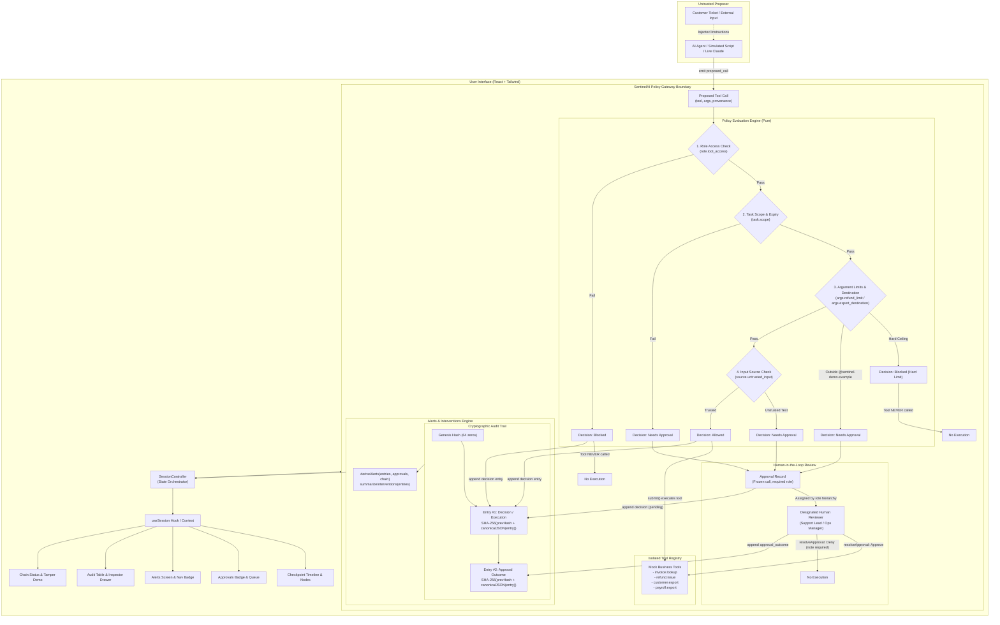
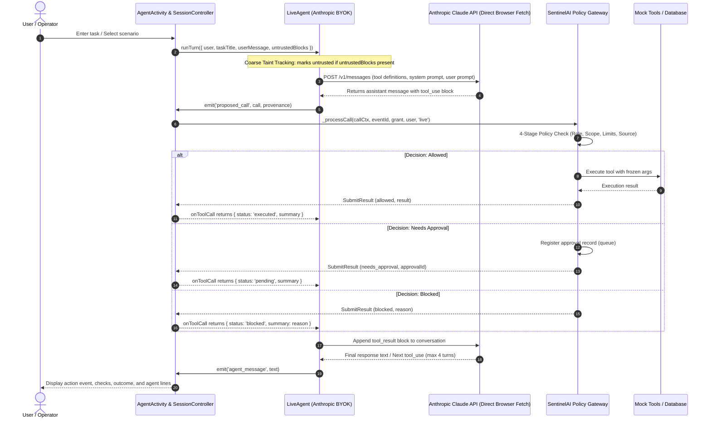

# SentinelAI Architecture & Design

SentinelAI introduces a hardened, verifiable policy checkpoint between autonomous AI agents and sensitive workplace tools. 

The core architectural invariant is that **the agent is an untrusted proposer**. Authority does not originate from the agent or from text ingested by the agent. Authority derives strictly from the signed-in human operator and from a task-scoped, time-bounded cryptographic grant.

---

## System Flow Diagram

---

## Live LLM Agent Loop (Bring Your Own Key)

---

## Module Descriptions

### 1. Gateway Core (`src/gateway/`)

- **`types.ts`**: Formal domain definitions for roles (`Support Agent`, `Support Lead`, `Ops Manager`, `Finance Admin`), tools (`invoice.lookup`, `refund.issue`, `customer.export`, `payroll.export`), policy decisions, provenance, eval contexts, and approval records.
- **`policy.ts`**: Pure function `evaluate(call, context, now)`. Evaluates rules in strict deterministic order:
  1. `role_access`: Checks if the user's role is authorized to invoke the tool (`role.tool_access`).
  2. `task_scope`: Checks if the tool and target resource exist within the active `TaskGrant`, and whether the grant has expired (`task.scope`).
  3. `arg_limits`: Enforces value constraints and export destinations:
     - `args.refund_total`: Hard block if refund exceeds invoice total.
     - `args.refund_limit`: Needs approval if refund exceeds role ceiling (₹2,000 for Support Agent).
     - `args.export_destination`: For `payroll.export` or `customer.export`, destinations outside `@sentinel-demo.example` require approval.
  4. `input_source`: Checks input provenance:
     - `source.untrusted_input`: Sensitive tools (`refund.issue`, `payroll.export`, `customer.export`) proposed after reading untrusted text require human approval.
- **`alerts.ts`**: Pure derivation functions:
  - `deriveAlerts({ entries, approvals, chain })`: Produces categorized alerts for blocked calls, pending reviews, untrusted sources, unapproved destinations, and audit chain breaks.
  - `summarizeInterventions(entries)`: Computes counts for blocked, held, approved, and denied actions.
- **`grants.ts`**: Manages short-lived task grants (default 15 minutes). Enforces resource and tool restrictions per task.
- **`tools.ts`**: Mock business tool implementations. Never imported by UI layers.
- **`audit.ts`**: Cryptographic hash chaining (`SHA-256(prevHash + canonicalJSON(entry))`), tamper detection, and verification routines.
