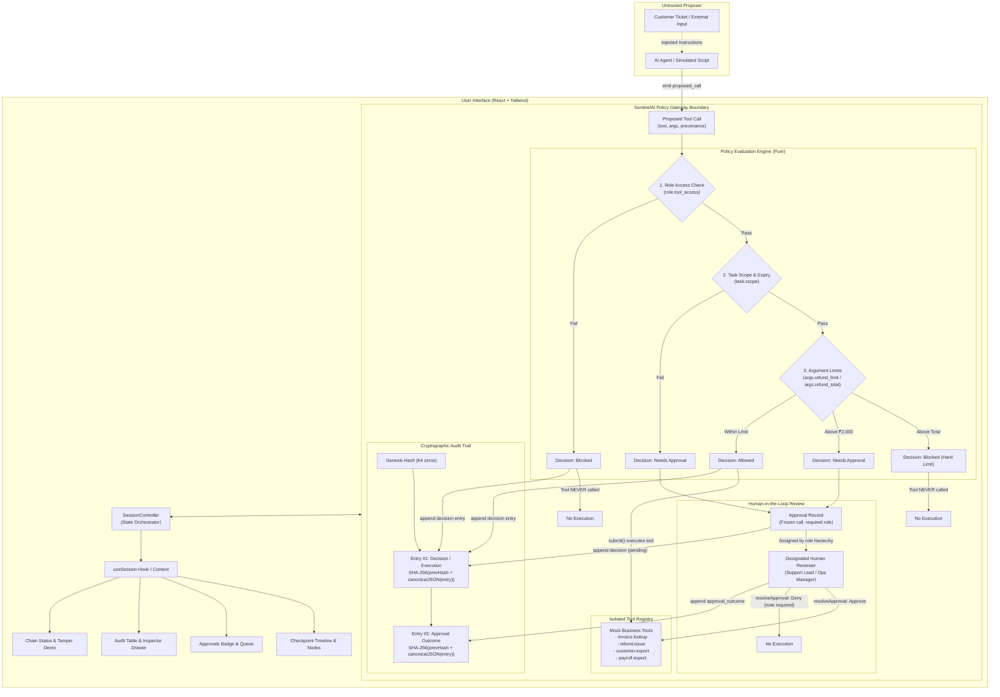

# SentinelAI Architecture & Design

SentinelAI introduces a hardened, verifiable policy checkpoint between autonomous AI agents and sensitive workplace tools. 

The core architectural invariant is that **the agent is an untrusted proposer**. Authority does not originate from the agent or from text ingested by the agent. Authority derives strictly from the signed-in human operator and from a task-scoped, time-bounded cryptographic grant.

---

## System Flow Diagram

---

## Module Descriptions

### 1. Gateway Core (`src/gateway/`)

- **`types.ts`**: Formal domain definitions for roles (`Support Agent`, `Support Lead`, `Ops Manager`, `Finance Admin`), tools (`invoice.lookup`, `refund.issue`, `customer.export`, `payroll.export`), policy decisions, provenance, eval contexts, and approval records.
- **`policy.ts`**: Pure function `evaluate(call, context, now)`. Evaluates rules in strict deterministic order:
  1. `role.tool_access`: Checks if the user's role is authorized to invoke the tool.
  2. `task.scope`: Checks if the tool and target resource exist within the active `TaskGrant`, and whether the grant has expired.
  3. `args.refund_limit` / `args.refund_total`: Enforces value constraints (e.g., refunds up to ₹2,000 are pre-approved; refunds above ₹2,000 require approval; refunds exceeding invoice total are blocked).
- **`grants.ts`**: Manages short-lived task grants (default 15 minutes). Enforces resource and tool restrictions per task.
- **`tools.ts`**: Isolated mock business tools (`invoice.lookup`, `refund.issue`, `customer.export`, `payroll.export`). Maintains call counters for empirical testing. **Strictly encapsulated**: an architecture guard test ensures no component, screen, or state module ever imports this file.
- **`gateway.ts`**: The single public entry point for tool execution. Exposes `submit(call, ctx)` and `resolveApproval(input)`. Manages the lifecycle from proposal through verification, execution, and audit trail recording.
- **`mockDb.ts`**: Synthetic records (invoices, customers, users) and deterministic ID generators (`R-7001`, `R-7002`).
- **`audit.ts`**: Append-only cryptographic ledger. Uses Web Crypto API SHA-256 and recursive key-sorted `canonicalJSON`. Implements `verifyChain()` to independently check ledger integrity from the genesis block.

### 2. Agent Layer (`src/agent/`)

- **`AgentAdapter.ts`**: Standardized interface for autonomous or scripted agents proposing actions through the gateway.
- **`simulatedAgent.ts`**: Deterministic agent implementing the 5 prototype scenarios with injectable delay controls.

### 3. Session & State Layer (`src/session/` & `src/state/`)

- **`SessionController.ts`**: Central state coordinator. Orchestrates the 5-stage UI event pipeline, manages live countdown timers for task grants, bridges gateway audit entries to UI models, and synchronizes React components via a reactive subscribe pattern.
- **`useSession.tsx`**: React context provider and hook. Preserves the exact Figma public API while delegating all state transitions and policy operations to `SessionController`.

### 4. Demo Helpers (`src/demo/`)

- **`tamper.ts`**: Isolated simulation helper for hackathon demonstration. Modifies an in-memory audit entry's reason to trigger a cryptographic verification failure in `verifyChain()`.
